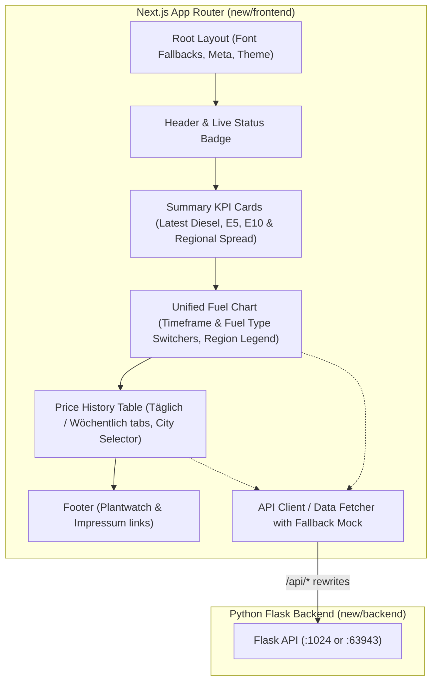

# Fuelsentinel Frontend Migration & Modernization Plan

## 1. Executive Summary & Objective

The goal is to migrate the legacy **fuelsentinel** frontend (built with Create React App, Bootstrap 5, and Billboard.js) into the new **Next.js 16 + React 19 + Tailwind CSS v4** project located in `new/frontend`, while significantly enhancing the UI, user experience, performance, and maintainability.

The application monitors and compares fuel prices (**Diesel**, **Super E5**, **Super E10**) across 6 German regions (**Aachen**, **Annaberg-Buchholz**, **Ansbach**, **Hamburg**, **Potsdam**, **Stuttgart**) across daily and weekly timescales.

---

## 2. Analysis of Current Legacy vs New State

| Aspect | Legacy Frontend (`legacy/frontend`) | Target Next.js Frontend (`new/frontend`) |
| :--- | :--- | :--- |
| **Framework** | Create React App (Deprecated, Webpack) | Next.js 16 (App Router, Turbopack, React 19) |
| **Styling** | Bootstrap 5 + hardcoded `#282c34` Dark CSS | Tailwind CSS v4 (`@import "tailwindcss"`) |
| **Charts** | 6 vertically stacked Billboard.js/D3 charts (heavy DOM manipulation, repetitive) | Unified interactive time-series chart with fuel & timeframe controls, interactive SVG/Canvas tooltips |
| **Data Presentation** | Basic unstyled HTML `<table>`, confusing toggle button "Alle" | Responsive dashboard with KPI summary cards, tabbed views, sortable/filterable tables |
| **Typography & Copy** | Typos ("Wöchtenlich", "Impressium"), raw link colors | Correct German orthography, accessible semantic HTML, refined typography |
| **Backend Connectivity** | CRA proxy (`http://127.0.0.1:5000/`) | Next.js proxy rewrites (`BACKEND_URL` fallback to `1024` or `5000`) + Mock fallback mode for local development |
| **Responsiveness** | Not optimized for mobile; table overflows | Fully responsive mobile-first grid layout |

---

## 3. Backend API Contract & Data Model

The Flask backend (`backend.py` / `backend-new.py`) provides the following endpoints:

```
GET /api/time
GET /api/day                           -> { prices: [{ date: "DD.MM.YYYY", diesel: "...", e5: "...", e10: "..." }] }
GET /api/week                          -> { prices: [{ date: KW_int, diesel: "...", e5: "...", e10: "..." }] }
GET /api/area/<area_id>/day            -> { prices: [{ date: "DD.MM.YYYY", diesel: "...", e5: "...", e10: "..." }] }
GET /api/area/<area_id>/week           -> { prices: [{ date: KW_int, diesel: "...", e5: "...", e10: "..." }] }
GET /api/charts/day/<fuel_type>        -> { data: { x: "x", columns: [["x", "YYYY-MM-DD", ...], ["Ansbach", ...], ...] } }
GET /api/charts/week/<fuel_type>       -> { data: { x: "x", columns: [["x", KW, ...], ["Ansbach", ...], ...] } }
```

### Region Mapping (`AREA_DICT`):
- `0`: Ansbach
- `1`: Potsdam
- `2`: Aachen
- `3`: Annaberg-Buchholz
- `4`: Hamburg
- `5`: Stuttgart

---

## 4. Architecture & UX/UI Redesign



### Key UI/UX Innovations:
1. **Interactive Chart Viewport**:
   - Single unified chart container instead of 6 separate vertical blocks.
   - Segmented toggle controls for **Fuel Type** (`Diesel` | `Super E5` | `Super E10`) and **Resolution** (`Täglich` | `Wöchentlich`).
   - Interactive tooltip displaying date/KW and fuel prices across all 6 regions simultaneously.
   - Clickable region legends to toggle specific cities on/off for easy comparison.
2. **KPI Overview Cards**:
   - Cards at the top displaying the current German average for Diesel, E5, and E10.
   - Lowest vs highest price variance between monitored cities.
3. **Enhanced Data Table**:
   - Clean tabular display with price formatted in Euro standard (`1,959 €`).
   - Visual badges for fastest increasing or cheapest prices.
   - Clear city selector dropdown / pills (Aachen, Annaberg-Buchholz, Ansbach, Hamburg, Potsdam, Stuttgart, or Alle Regionen).
4. **Resilient Local Development**:
   - When the PostgreSQL/InfluxDB database or Flask service is not running locally, the frontend falls back gracefully to realistic cached historical sample data derived from `legacy_data.csv`, enabling offline development and testing.

### 4.1 Deep Dive: Chart Implementation Strategy (Evaluating D3, Billboard.js, & Declarative SVG)

The legacy app used `billboard.js` (`^3.4.1`) with `react-billboardjs` (`^3.0.2`), which created several architectural problems:
- `react-billboardjs` is unmaintained and incompatible with **React 19** and the **Next.js App Router** (direct imperative DOM mutations conflicting with React 19 concurrent hydration).
- Billboard.js relies on old global CSS stylesheets (`billboard.css`) with fixed styling that does not blend with modern Tailwind CSS theming or dark/light modes.
- Rendering 6 separate instances led to heavy bundle sizes and duplicate DOM trees.

#### Evaluation of Approaches:

| Strategy | Pros | Cons | Verdict |
| :--- | :--- | :--- | :--- |
| **A. Billboard.js core (`bb.generate`)** | Reuses legacy D3-based Billboard logic directly. | Imperative DOM-stealing; difficult to style with Tailwind; conflicts with React 19 hydration; heavy bundle size (~120kB minified). | ❌ Not recommended for Next.js 16 / React 19. |
| **B. Chart.js / Recharts** | Well known, feature complete. | Recharts has historically suffered React 19 peer-dependency mismatches; Chart.js is HTML5 Canvas-based (tooltips and responsive resizing require custom HTML canvas plugins and don't integrate natively into Tailwind DOM styling). | ⚠️ Suboptimal. |
| **C. D3 for Math + Declarative React SVG + Tailwind (Selected)** | **Best of both worlds**: D3 calculates geometric projections (scales, paths, domain bounds), while React declaratively renders `<svg>`, `<path>`, `<circle>`, and Tailwind styles all tooltips, crosshairs, and transitions. 100% hydration safe, zero peer-dependency conflicts with React 19, zero DOM-stealing. | Requires custom component layout (which we fully build for `FuelChart.tsx`). | ✅ **Recommended & Selected Approach**. |

#### Concrete Implementation of `FuelChart.tsx`:
1. **Data Ingestion & Normalization**:
   - The Flask backend sends Billboard-formatted columnar data:
     `{ data: { x: 'x', columns: [['x', '2022-05-01', ...], ['Ansbach', 1.95, ...], ...] } }`
   - A dedicated parser transforms this matrix into a unified time-series format:
     `{ timestamp: number, dateLabel: string, values: { [city: string]: number } }[]`.
2. **Coordinate & Scale Calculations**:
   - **X-Scale**: Linear/time distribution mapping data points to SVG viewBox coordinates (`0` to `width`).
   - **Y-Scale**: Dynamic bounds calculated from `[minPrice - padding, maxPrice + padding]` mapping to `[height, 0]`.
   - **Grid & Tick Generators**: Horizontal dashed grid lines at round Euro intervals (e.g. `1.90 €`, `1.95 €`, `2.00 €`).
3. **Smooth Path Generation**:
   - Monotone cubic Bézier path smoothing (`M x0 y0 C ...`) for aesthetic line curves.
   - Interactive hover points (`<circle>`) that illuminate along the curve when hovering.
4. **Interactive Crosshair & Hover Tooltip**:
   - Mouse / Touch tracking across the chart width calculating the nearest data index.
   - Vertical guideline (`stroke-dashed`) snapping to the active day/KW.
   - Floating Tailwind glassmorphism card (`backdrop-blur-md bg-slate-900/90 border border-slate-700/60 shadow-xl`) showing:
     - Formatted Date / Calendar Week
     - Sorted regional fuel prices (lowest to highest) with corresponding color indicators
     - Average price across active regions
5. **Interactive Controls**:
   - **Fuel Selector Pills**: Instant tab switching between `Diesel` (Amber), `Super E5` (Emerald), and `Super E10` (Blue).
   - **Timeframe Selector**: Segmented control between `Täglich (Datum)` and `Wöchentlich (KW)`.
   - **Interactive Region Legend**: Clickable badges for the 6 cities (Aachen, Annaberg-Buchholz, Ansbach, Hamburg, Potsdam, Stuttgart) allowing users to toggle individual cities on/off to isolate comparisons.

---

## 5. Detailed Implementation Steps

### Phase 1: Environment & Build Foundation
- Fix font loading in [layout.tsx](file:///home/simon/code/ai/fuelsentinel2/new/frontend/app/layout.tsx) by removing remote Google Font network requests and providing a clean local font stack.
- Configure [next.config.ts](file:///home/simon/code/ai/fuelsentinel2/new/frontend/next.config.ts) with API rewrites pointing to `http://127.0.0.1:1024` (or `process.env.BACKEND_URL`).
- Verify `npm run build` succeeds cleanly in Turbopack.

### Phase 2: Type Definitions & Data Layer
- Create `types/fuel.ts` defining:
  - `FuelType`: `'diesel' | 'e5' | 'e10'`
  - `TimeResolution`: `'day' | 'week'`
  - `AreaInfo`: `{ id: number; name: string }`
  - `PriceEntry`: `{ date: string | number; diesel: number; e5: number; e10: number }`
  - `ChartData`: parsed multi-series time-series representation.
- Create `lib/api.ts` with API fetch helper, error handling, and mock fallback dataset for seamless offline operation.

### Phase 3: Modern UI Components
- **`components/Navbar.tsx`**: Clean brand banner with animated status pill and subtitle.
- **`components/KpiCards.tsx`**: Top summary metric cards for Diesel, E5, and E10.
- **`components/FuelChart.tsx`**: Responsive interactive SVG time-series chart with crosshair, hover cards, fuel selector pills, and region toggles.
- **`components/PriceTable.tsx`**: Styled Tailwind table with Daily/Weekly toggle and Region dropdown/chips.
- **`components/Footer.tsx`**: Polished footer with links to plantwatch.de and Impressum.

### Phase 4: App Integration & Page Assembly
- Assemble the dashboard in [page.tsx](file:///home/simon/code/ai/fuelsentinel2/new/frontend/app/page.tsx).
- Add loading skeletons and error states for network latency or offline backend.
- Enhance [globals.css](file:///home/simon/code/ai/fuelsentinel2/new/frontend/app/globals.css) with Tailwind custom styles if needed.

### Phase 5: Verification & Testing
- Run `npm run build` to ensure zero compilation or Turbopack errors.
- Run `npm run lint` to ensure code compliance.
- Verify chart interactions, tab switches, and responsive layout across desktop and mobile screen sizes.

---

## 6. Review & Feedback Request
Please review this plan. Upon your approval, we will proceed with the implementation in `new/frontend`.
