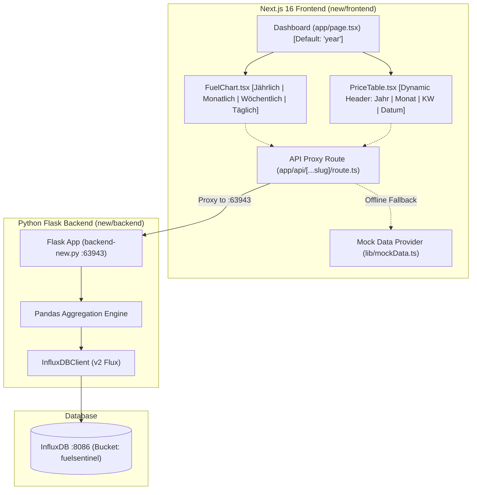

# Fuelsentinel Plan: InfluxDB Backend (`backend-new.py`) with "Monatlich" (Last 12 Months) & "Jährlich" (Default)

## 1. Executive Summary & Objective

This plan encompasses:
1. Migrating to **`backend-new.py`** powered by **InfluxDB** and Pandas.
2. Adding a **"Monatlich" (Monthly)** time resolution displaying the **last 12 months** of price history across both charts and tables.
3. Supporting the complete four-tier resolution suite:
   - **"Jährlich" (Yearly)** — **Default** macro overview (multi-year comparison 2020–2024).
   - **"Monatlich" (Monthly)** — Rolling last 12 months overview.
   - **"Wöchentlich" (Weekly)** — Calendar weeks (KW).
   - **"Täglich" (Daily)** — Day-by-day granularity.

---

## 2. Architecture & Data Flow



---

## 3. Backend Implementation: `backend-new.py` (InfluxDB)

### 3.1 Environment & Entrypoint
- In `new/backend/.flaskenv`: Set `FLASK_APP=backend-new.py`.
- Port alignment: `backend-new.py` serves on port **`63943`**.

### 3.2 InfluxDB Query Range Function
`get_daily_station_data(range_start="-1y")`:
- For `"month"`, `"week"`, and `"day"`: uses default `range_start="-1y"` (fetching the rolling 12 months).
- For `"year"`: uses `range_start="-5y"` to include all multi-year records.

### 3.3 New "Monatlich" (Monthly) Endpoints
1. **`GET /api/month`**:
   - Aggregates by `df['_time'].dt.strftime('%Y-%m')`.
   - Returns `{ 'prices': [{ 'date': 'MM/YYYY', 'diesel': '...', 'e5': '...', 'e10': '...' }, ...] }` for the last 12 months sorted chronologically descending.
2. **`GET /api/area/<area_number>/month`**:
   - Filters by `area_number` and aggregates monthly for the last 12 months.
3. **`GET /api/charts/month/<fuel_type>`** & **`GET /api/charts/month`**:
   - Formats columnar output for the last 12 months:
     `{ 'data': { 'x': 'x', 'columns': [['x', '2021-07', '2021-08', ..., '2022-06'], ['Ansbach', ...], ...] } }`

### 3.4 New "Jährlich" (Yearly) Endpoints
1. **`GET /api/year`**:
   - Aggregates by `df['_time'].dt.year`.
   - Returns annual averages sorted descending.
2. **`GET /api/area/<area_number>/year`**:
   - Area-specific annual averages.
3. **`GET /api/charts/year/<fuel_type>`** & **`GET /api/charts/year`**:
   - Columnar annual series: `[['x', 2020, 2021, 2022, 2023, 2024], ...]`.

---

## 4. Frontend Implementation

### 4.1 Type System (`new/frontend/types/fuel.ts`)
```typescript
export type TimeResolution = "year" | "month" | "week" | "day";
```

### 4.2 Mock Data & Next.js API Fallback Proxy
- In `lib/mockData.ts`:
  - `getMockMonthPrices(areaId?: number)`: Generates 12 monthly data points representing the last 12 months.
  - `getMockYearPrices(areaId?: number)`: Multi-year German averages (2020–2024).
  - Update `getMockChartData(timeframe, fuelType)` to support `"month"` and `"year"`.
- In `app/api/[...slug]/route.ts`:
  - Proxy default port set to `63943`.
  - Handle `path === "month"` and `path.startsWith("charts/month/")`.
  - Handle `path === "year"` and `path.startsWith("charts/year/")`.

### 4.3 Data Formatter (`lib/api.ts`)
- In `parseChartColumns`:
  - If ISO year-month string (`"YYYY-MM"`): Format as `"MM/YY"` (e.g. `"05/22"`).
  - If 4-digit year (`"2024"`): Display `"2024"`.
  - If ISO date (`"YYYY-MM-DD"`): Format as `"DD.MM."`.
  - If KW number: Format as `"KW <nr>"`.

### 4.4 UI Components
- **`FuelChart.tsx`**:
  - Update resolution switcher tabs to:
    `[ Jährlich | Monatlich | Wöchentlich | Täglich ]`
  - Highlight the active tab (amber pill).
  - Responsive SVG path and tick formatting for 12 monthly points.
- **`PriceTable.tsx`**:
  - Add `"Monatlich"` tab.
  - Dynamic table header:
    - `"year"` -> **Jahr**
    - `"month"` -> **Monat**
    - `"week"` -> **Kalenderwoche (KW)**
    - `"day"` -> **Datum**
- **`app/page.tsx`**:
  - Default resolution state remains `"year"`:
    ```typescript
    const [chartResolution, setChartResolution] = useState<TimeResolution>("year");
    const [tableResolution, setTableResolution] = useState<TimeResolution>("year");
    ```

---

## 5. Execution & Verification Steps

1. **Backend Updates (`new/backend`)**:
   - Update `.flaskenv` to `FLASK_APP=backend-new.py`.
   - Update `backend-new.py` with both `year` and `month` endpoints, plus `adjust_to_charts_month` and `adjust_to_charts_year`.
   - Verify syntax with `python3 -m py_compile new/backend/backend-new.py`.
2. **Frontend Updates (`new/frontend`)**:
   - Update `types/fuel.ts` (`TimeResolution`).
   - Update `lib/mockData.ts` and `lib/api.ts` with 12-month data and formatting.
   - Update `app/api/[...slug]/route.ts` to proxy to port `63943` and handle `month`/`year`.
   - Update `FuelChart.tsx` and `PriceTable.tsx` with `"Monatlich"` tab and dynamic headers.
   - Keep `"year"` as the initial default state in `app/page.tsx`.
3. **Documentation**:
   - Synchronize `new/frontend/doc/plan001.md`.
4. **Verification**:
   - Run `npm run lint` and `npm run build` in `new/frontend`.

---

## 6. Review & Feedback Request
Please review this updated plan. Upon your approval, we will proceed with the implementation!
